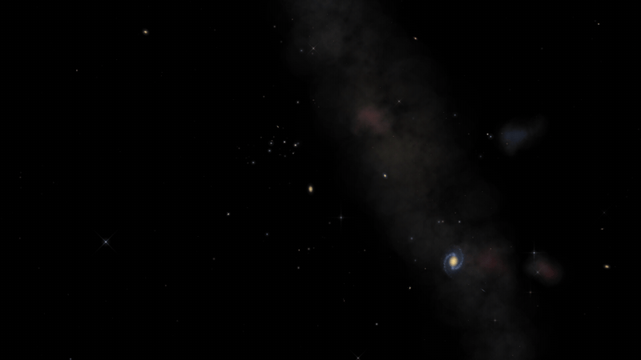

<div align="center">

# 🌠 Starfield

Wallpaper animado de céu noturno feito com **HTML e JavaScript puros**: leve, personalizável e pronto para o **Wallpaper Engine**.



<br>
<sub>Preview com eventos acelerados para caberem em poucos segundos</sub>
<br><br>

[](https://erickfuzer.github.io/Starfield/)

</div>

Um céu noturno procedural: cada vez que abre, nasce um céu diferente. O fundo é preto puro (`#000000`), ideal para telas OLED.

## O que tem no céu

**Fixo no fundo**
- **Estrelas por classe espectral** (M, K, G, F, A, B e O), cada uma com cor, tamanho e frequência próprios, cintilando em ritmos diferentes
- **Spikes de difração** nas estrelas mais brilhantes, em cruz ou diagonal, com cintilação atmosférica
- **Aglomerados estelares** com distribuição gaussiana
- **Via Láctea** atravessando a tela, com bojo central, faixas de poeira escura e estrelas concentradas na banda
- **Nebulosas** irregulares e filamentosas, em cores de emissão, reflexão e roxo, quase sempre perto do plano da galáxia
- **Galáxias** espirais (com ou sem barra, de 2 ou 3 braços, de frente ou de perfil com faixa de poeira) e elípticas, com núcleo pulsante e avermelhamento pela distância

**Eventos que passam**

| Evento | Detalhe | Intervalo médio |
|---|---|---|
| Estrela cadente | Cores pela composição do meteoro; às vezes um bólido lento e colorido | ~40 s |
| Satélite | Pode dar um *flare* (reflexo do painel solar) ou sumir na sombra da Terra | ~1 min |
| Avião | Luzes de navegação vermelha e verde, strobe duplo e beacon | ~4 min |
| Trem Starlink | Fileira de satélites se espaçando, que às vezes some um a um na sombra | ~5 min |
| OVNI | Raro: movimento errático, cores piscando e saída em disparada | ~6 min |
| Chuva de meteoros | 8 a 15 meteoros saindo do mesmo ponto do céu | ~20 min |

## Personalização

No **Wallpaper Engine**, tudo aparece como controle deslizante nas propriedades do wallpaper e muda sem reiniciar:

- **FPS máximo** (15 a 60, padrão 30)
- **Céu fixo:** 0 gera um céu novo a cada início; qualquer outro número repete sempre o mesmo céu
- **Intensidade** da Via Láctea, nebulosas, galáxias, estrelas de fundo e vinheta (0 desliga)
- **Frequência** de cada evento (0 desliga, 2 = o dobro, até 3×)

**No navegador**, as mesmas opções funcionam como parâmetros na URL:

```
index.html?fps=60&seed=42&milkyWay=0.8&ufos=0&shootingStars=2
```

<details>
<summary>Ver todos os parâmetros</summary>

| Parâmetro | Padrão | O que faz |
|---|---|---|
| `fps` | 30 | Limite de quadros por segundo |
| `seed` | 0 | 0 = céu aleatório; outro número = sempre o mesmo céu |
| `starDensity` | 0.00028 | Estrelas cintilantes por pixel² |
| `backgroundStars` | 0.3 | Estrelas fracas de fundo |
| `milkyWay` | 0.5 | Intensidade da Via Láctea |
| `nebulae` | 0.55 | Intensidade das nebulosas |
| `galaxies` | 1 | Intensidade das galáxias |
| `vignette` | 0.55 | Escurecimento das bordas |
| `shootingStars` | 1 | Frequência de estrelas cadentes |
| `meteorShowers` | 1 | Frequência de chuvas de meteoros |
| `satellites` | 1 | Frequência de satélites |
| `starlink` | 1 | Frequência de trens Starlink |
| `airplanes` | 1 | Frequência de aviões |
| `ufos` | 1 | Frequência de OVNIs |

</details>

## Desempenho

- O céu estático (Via Láctea, nebulosas, discos das galáxias) é desenhado **uma única vez** e reaproveitado a cada quadro
- Estrelas e núcleos de galáxias usam **sprites pré-renderizados**, sem recalcular gradientes no loop
- **30 FPS por padrão**, e o relógio dos eventos só anda enquanto a página está visível

## Como usar

Baixe o repositório pelo botão **Code → Download ZIP** e extraia.

**Wallpaper Engine**
1. Clique em **Abrir wallpaper → Abrir de um arquivo** (*Open Wallpaper → Open from File*)
2. Selecione o arquivo `project.json`, que já vem com os controles de personalização
3. Ajuste as propriedades no painel lateral

**Lively Wallpaper** ([alternativa gratuita e open source](https://github.com/rocksdanister/lively))
- Arraste o `index.html` para a janela do Lively

**Navegador ou fundo de site**
- Abra o `index.html` direto, sem servidor nem dependências, ou embuta como fundo:

```html
<iframe src="index.html" style="position:fixed;inset:0;width:100%;height:100%;border:none;z-index:-1;"></iframe>
```

## Estrutura

```
Starfield/
├── index.html          # o wallpaper
├── project.json        # configuração e controles do Wallpaper Engine
├── preview.gif         # prévia do README e do Wallpaper Engine
├── social-preview.jpg  # imagem da prévia de link
├── LICENSE
└── README.md
```

## Créditos

Desenvolvido com o auxílio do [Claude](https://claude.ai) (Anthropic) na arquitetura dos efeitos e na otimização do código.

## Licença

[MIT](LICENSE): use, modifique e distribua à vontade.

<div align="center">
<sub>Feito por <a href="https://github.com/erickfuzer">Erick Fuzer</a></sub>
</div>
